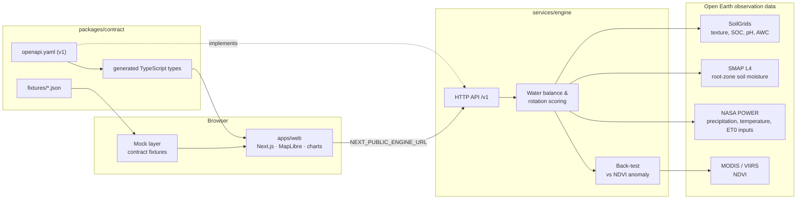

# Travertine

**Crop-rotation decision support built on Earth observation data.**

Travertine helps a farmer answer one question: *what should this field grow over the next three to five years?*
Mark a field on the map, say what matters most — saving water, income, soil health or lower risk — and explore
ranked rotation strategies scored against two decades of satellite and reanalysis records for that exact location.

Built for the NASA Space Apps Challenge 2026, challenge **"Field Shift: Adapting Farms with NASA Data"**.
Demo region: Denizli and the Büyük Menderes basin, Turkey. Works for any coordinate on Earth.

> Travertine is an independent project. It uses openly published NASA Earth science data, but it is not
> affiliated with, endorsed by or sponsored by NASA.

## What makes it different

| | |
|---|---|
| **Back-tested** | The model's water-stress estimate is replayed against past years and compared with observed vegetation (NDVI) anomalies. The correlation, sample size, method and caveats are shown in the app, unedited. |
| **Honest provenance** | Every number on screen names its dataset, provider, spatial resolution, temporal coverage and uncertainty, with a link to the source. |
| **Trade-offs, not one answer** | Priorities are sliders. Rankings update live, and any two rotations can be compared side by side, year by year. |
| **Built to be used** | Responsive down to a phone, keyboard accessible, English and Turkish, printable one-page plan, works offline for the last analysed field. |

## Architecture



The **contract comes first**. `packages/contract/openapi.yaml` is the single source of truth for every request and
response. The web app is generated against it and runs entirely on its fixtures when no engine is configured, showing a
"Demo data" badge whenever it does. The engine implements the same contract.

## Repository layout

```
apps/web/              Next.js web app (App Router, TypeScript strict, Tailwind CSS)
services/engine/       Data and modelling service implementing the /v1 contract
packages/contract/     openapi.yaml, one JSON fixture per endpoint, generated types
docs/                  Methodology, AI use statement, decisions
.claude/skills/        Project rules for Claude Code agents (design, accessibility, data truth...)
.github/workflows/     CI: lint, type-check, test and build
```

## Getting started

Requirements: Node.js 22 or newer and pnpm 12 (`corepack enable`).

```bash
git clone https://github.com/musbabaff/travertine.git
cd travertine
pnpm install
pnpm dev            # http://localhost:3000, runs on contract fixtures
```

To point the web app at a running engine, copy `.env.example` to `apps/web/.env.local` and set
`NEXT_PUBLIC_ENGINE_URL`. Engine setup lives in [`services/engine/README.md`](services/engine/README.md).

Useful commands:

```bash
pnpm lint           # ESLint across workspaces
pnpm typecheck      # TypeScript, strict
pnpm test           # Vitest unit tests
pnpm contract:lint  # validate openapi.yaml
pnpm contract:gen   # regenerate TypeScript types from openapi.yaml
```

## Data sources

All data is openly available. The authoritative list is whatever the engine returns in each response's
`provenance` array, rendered in the app's **Data** view with resolution, coverage and access link. Planned sources:

- NASA POWER — daily meteorology and solar inputs used to compute reference evapotranspiration (FAO-56)
- SMAP Level-4 — modelled root-zone soil wetness
- MODIS / VIIRS vegetation indices — NDVI used for the back-test
- ISRIC SoilGrids — soil texture, organic carbon, pH and derived available water capacity
- FAO-56 — crop coefficients (Kc) and rooting depths

## Team

| Role | Owns |
|---|---|
| Web lead | `apps/web`, `packages/contract`, `.claude`, repo tooling |
| Engine lead | `services/engine` |

Both developers work with Claude Code agents under human review — see [`docs/AI_USE.md`](docs/AI_USE.md) and
[`CLAUDE.md`](CLAUDE.md).

## Licence

[MIT](LICENSE)
