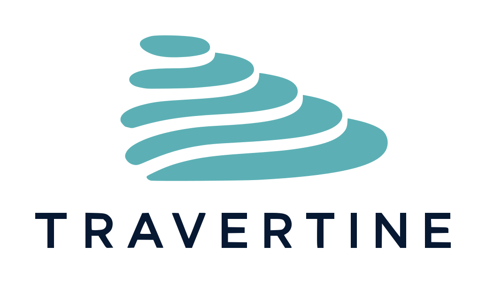
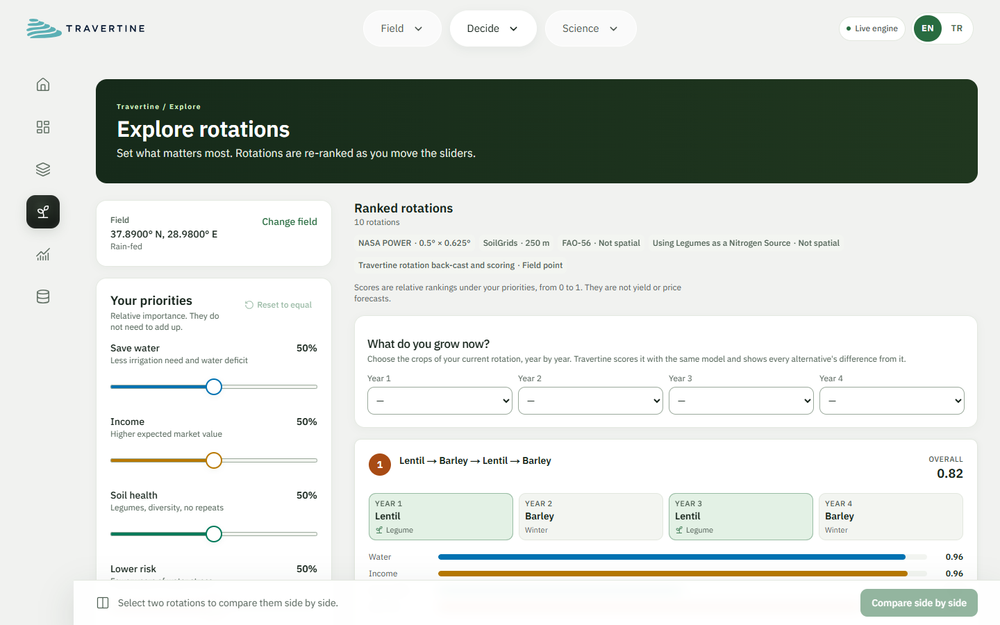
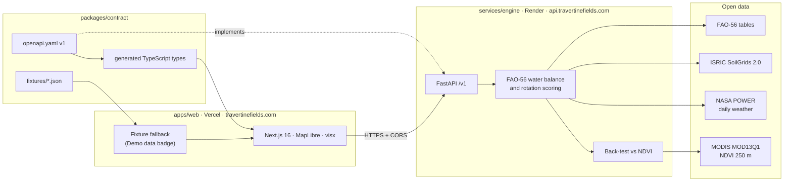

<p align="center"></p>

<p align="center"><strong>English</strong> | <a href="README.tr.md">Türkçe</a></p>

<p align="center">
  <a href="https://github.com/musbabaff/travertine/actions/workflows/ci.yml"></a>
  <a href="LICENSE"></a>
  <a href="https://github.com/musbabaff/travertine/releases/latest"></a>
  <a href="https://travertinefields.com"></a>
</p>

# Travertine

**Travertine helps a farmer compare three- to five-year crop rotations for one field, scored against that field's
own climate, soil and satellite vegetation record.**

**Live site: [travertinefields.com](https://travertinefields.com)**



> Built for the NASA Space Apps Challenge 2026, challenge **"Field Shift: Adapting Farms with NASA Data"**.
> Travertine is an independent project. It uses openly published NASA Earth science data, but it is **not affiliated
> with or endorsed by NASA**.

## The problem

Farms in dry regions such as the Büyük Menderes basin in Türkiye face hotter, more variable growing seasons. Which
crops to grow, and in what order, decides how much water a field needs and how often it runs short. Long climate and
satellite records exist for every field on Earth, but they are rarely turned into an answer a farmer can use for a
specific field.

## What Travertine does

Mark a field on a map. Travertine reads 25 years of daily NASA POWER weather for that location, the SoilGrids soil
profile and the MODIS vegetation record. It then replays every valid crop rotation through an FAO-56 daily soil-water
balance over every historical window. You set what matters most (saving water, income, soil health, lower risk) and
the rotations are re-ranked. Every number names its dataset, resolution and caveats, and the model is checked against
observed vegetation, with the result shown whether or not it is flattering.

## Key features

### Available now

- **Field**: draw a boundary or drop a point on a map with satellite imagery, or search for a place. Field summary:
  climate means for 2001–2025, rainfall against reference evapotranspiration by year, SoilGrids texture, organic
  carbon, pH and available water, and growing-season NDVI at 250 m (MODIS) beside 30 m (HLS) where available.
- **Explore**: four priority sliders and a 3-, 4- or 5-year horizon re-rank the engine's rotations. Each card shows
  the crop sequence, four scores on one 0–1 scale, the engine's explanations and per-year water demand and deficit.
  Any two rotations can be compared side by side.
- **Evidence**: the back-test of modelled water stress against observed NDVI anomalies, with correlation, n, method
  and caveats exactly as returned, by-year and scatter views, and a model-versus-baseline comparison with 95 %
  intervals when the engine returns them.
- **Provenance everywhere**: every section carries source chips with provider, resolution, coverage and a link.
- **Honest fallback**: if the engine is unreachable, the app shows contract fixtures for the demo field and says so in
  a "Demo data" badge; it never mixes demo values with a different location silently.
- **English and Turkish**, shareable URLs for field and priorities, keyboard accessible, responsive down to 390 px.

### Planned

- Data page (provenance table for everything on screen), landing page and field overview dashboard.
- Rotation plan with a printable one-page PDF, crop library, saved fields compared side by side.
- Farmer inputs: allowed crops, own soil-test values and own crop prices (need contract fields first).
- Climate and soil pages, methodology page, CSV exports, settings.
- Installable app with the last field available offline, guided first-run tour.
- Engine: 30 m HLS NDVI endpoint (in review), climate trend statistics, multi-site validation.

## How it works

1. **Mark the field.** Draw it or drop a point; the location goes into the URL so the view can be shared.
2. **The engine reads the record.** NASA POWER daily weather (2001 to the last full year), FAO-56 Penman-Monteith
   reference evapotranspiration, SoilGrids soil and available water, MODIS NDVI.
3. **Rotations are replayed, ranked and checked.** Each rotation runs through a daily FAO-56 soil-water balance over
   every past window; scores follow your priorities; the Evidence page shows how well the stress signal matched what
   satellites saw.

## Architecture



The contract comes first: `packages/contract/openapi.yaml` defines every request and response, the web app uses types
generated from it, and the engine is tested against it.

## NASA and open data used

The engine returns the datasets behind every response in its `provenance` array; this table summarises
[`docs/DATA_SOURCES.md`](docs/DATA_SOURCES.md).

| Dataset | Provider | Resolution | What we use it for | Link |
|---|---|---|---|---|
| NASA POWER daily point data (Agroclimatology; MERRA-2 meteorology, CERES SYN1deg radiation) | NASA Langley Research Center, POWER Project | 0.5° × 0.625° (meteorology), 1° × 1° (solar) | Daily weather 2001–last full year; reference evapotranspiration; water balance | [API](https://power.larc.nasa.gov/docs/services/api/temporal/daily/) |
| MODIS/Terra Vegetation Indices MOD13Q1 v061 | NASA LP DAAC, via the ORNL DAAC MODIS web service | 250 m | Growing-season NDVI; observed series of the back-test | [Web service](https://modis.ornl.gov/data/modis_webservice.html) |
| SoilGrids 2.0 | ISRIC — World Soil Information | 250 m | Texture, organic carbon, pH, available water capacity | [API](https://rest.isric.org/soilgrids/v2.0/docs) |
| FAO Irrigation and Drainage Paper 56 | FAO | Not spatial | ET0 equations; crop coefficients, stage lengths, rooting depth | [Online edition](https://www.fao.org/4/x0490e/x0490e00.htm) |
| Harmonized Landsat Sentinel-2 (HLS) v2.0 — *in review* | NASA LP DAAC, via Microsoft Planetary Computer | 30 m | Field-scale NDVI (2020 onwards) | [Dataset](https://planetarycomputer.microsoft.com/dataset/hls2-l30) |
| GPM IMERG — *planned* | NASA GES DISC | 0.1° | Independent precipitation cross-check | — |

Basemaps: OpenFreeMap (OpenStreetMap data); satellite imagery from Esri World Imagery (with an ArcGIS API key) or, without a key, EOX Sentinel-2 cloudless 2016 (CC BY 4.0). Place search: Photon (OpenStreetMap).

## Evidence and validation

The protocol was fixed before any result was computed: [`docs/VALIDATION.md`](docs/VALIDATION.md). For the demo field
(37.89 N, 28.98 E), 2002–2025, n = 24 years:

| Series | Pearson r with NDVI anomaly | 95 % bootstrap interval |
|---|---|---|
| Model: winter-wheat water balance | −0.66 | −0.85 to −0.43 |
| Baseline: dryness index 1 − P/ET0 | −0.53 | −0.74 to −0.26 |
| Difference, model − baseline | −0.14 | −0.34 to +0.03 |

**Verdict under the pre-registered rule: no detectable difference.** Both series correlate with greenness in the
expected direction, but the interval of the difference includes zero, so the data do not show that the water balance
beats the plain dryness index at this pixel. Caveats from the engine: the land use of the 250 m pixel is unknown,
irrigation is not represented, and 24 years is a small sample that shows association, not causation. This checks a
dryness signal at one pixel; it does not validate deficits, yields or rankings. See also
[`docs/MODEL_CARD.md`](docs/MODEL_CARD.md) and [`docs/METHODOLOGY.md`](docs/METHODOLOGY.md).

## Quick start

### Web

Requirements: Node.js 22 or newer, pnpm 12 (`corepack enable`).

```bash
git clone https://github.com/musbabaff/travertine.git
cd travertine
pnpm install
pnpm dev                 # http://localhost:3000, runs on contract fixtures
```

To use an engine, set `NEXT_PUBLIC_ENGINE_URL` in `apps/web/.env.local` (see [`.env.example`](.env.example)), for
example `http://localhost:8000` or `https://api.travertinefields.com`.

### Engine

Requirements: Python 3.12 and [uv](https://docs.astral.sh/uv/).

```bash
cd services/engine
uv sync
uv run python -m uvicorn travertine_engine.main:app --reload --port 8000
```

Interactive API docs are served at `/docs`. Details: [`services/engine/README.md`](services/engine/README.md).

## Repository structure

```
apps/web/              Next.js web app (App Router, TypeScript strict, Tailwind CSS 4)
services/engine/       FastAPI engine implementing the /v1 contract (Python 3.12, uv)
packages/contract/     openapi.yaml, one fixture per endpoint, generated TypeScript types
docs/                  Methodology, data sources, model card, validation, AI use, brand
.claude/skills/        Project rules for the coding agents (design, accessibility, data truth, charts, review)
.github/               CI, deploy checks, issue and PR templates
```

## API overview

The full contract is [`packages/contract/openapi.yaml`](packages/contract/openapi.yaml) (OpenAPI 3.1, version 1).

| Endpoint | Purpose |
|---|---|
| `GET /v1/health` | Service status |
| `GET /v1/crops` | Crop catalogue with FAO-56 coefficients and sources |
| `POST /v1/field/analyze` | Climate record, soil and NDVI history for a field |
| `GET /v1/field/ndvi` | 30 m HLS NDVI history (contract ready, engine in review) |
| `POST /v1/rotations/explore` | Ranked rotations under the given priorities and horizon |
| `GET /v1/validation` | Back-test of modelled stress against NDVI anomalies |

Every data response carries a `provenance[]` array.

## Testing and quality

CI runs on every pull request and on `main`; `main` is protected and only accepts pull requests with passing checks.

- **Web and contract**: OpenAPI lint, check that generated types are up to date, colour-contrast check of the design
  tokens, ESLint, TypeScript strict type-check, Vitest unit tests (including contract-fixture validation and
  English/Turkish key parity), production build, and Playwright end-to-end tests with an axe accessibility scan.
- **Engine**: pytest unit, property and contract tests (no network). Ruff and strict mypy are run locally as
  documented in the engine README; they are not yet CI steps.
- **Deploy check**: after each web merge, CI confirms that production serves the merged commit.

## Roadmap

See [Planned](#planned) above and the [changelog](CHANGELOG.md). Submission for the challenge closes on
16 November 2026.

## Team

| Name | Role |
|---|---|
| Mustafa Babayev ([@musbabaff](https://github.com/musbabaff)) | Product & Web Lead |
| Kemal Gencel ([@r0ine](https://github.com/r0ine)) | Science Engine Lead |

## Use of AI

Both developers work with Claude Code (Anthropic) agents: one owns the web app and contract, the other the engine.
The agents write code, tests and documentation drafts under rules in [`CLAUDE.md`](CLAUDE.md) and
[`.claude/skills/`](.claude/skills); humans review every change before merge. No AI image generation is used for the
brand assets. The full statement and log: [`docs/AI_USE.md`](docs/AI_USE.md).

## Licence

[MIT](LICENSE) © 2026 The Travertine team.

## Acknowledgements

- NASA POWER Project (NASA Langley Research Center) for daily meteorological and solar data.
- NASA LP DAAC and the ORNL DAAC MODIS web service for MOD13Q1 NDVI (Didan 2021, doi:10.5067/MODIS/MOD13Q1.061).
- ISRIC — World Soil Information for SoilGrids 2.0 (CC BY 4.0).
- FAO for Irrigation and Drainage Paper 56.
- OpenStreetMap contributors, OpenFreeMap, EOX (Sentinel-2 cloudless) and Photon for maps and search.
- IBM Plex Sans (SIL Open Font License).
- The NASA Space Apps Challenge organisers.
