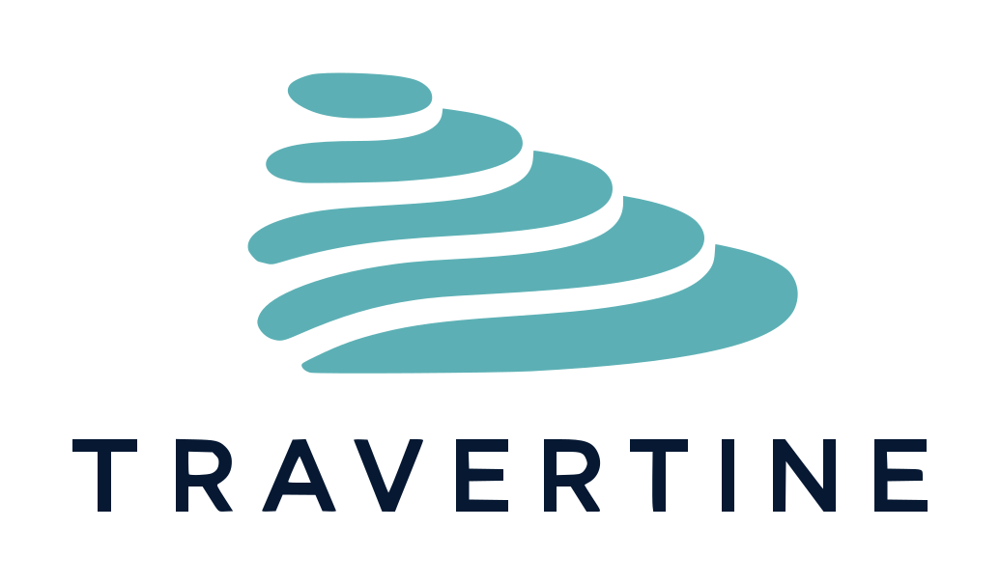
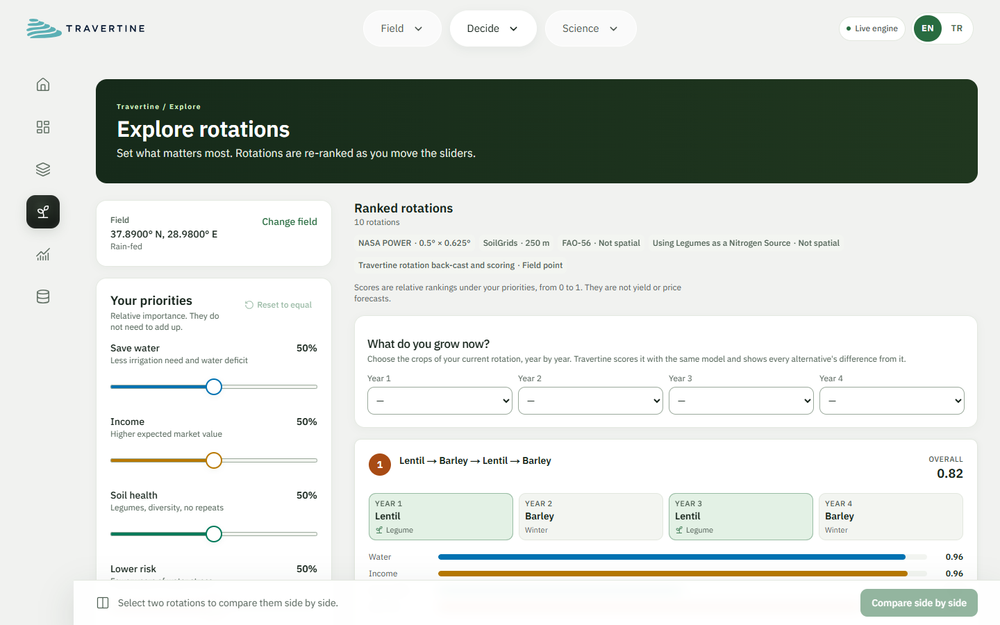
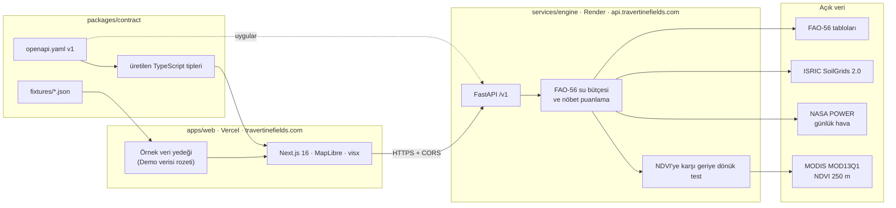

<p align="center"></p>

<p align="center"><a href="README.md">English</a> | <strong>Türkçe</strong></p>

<p align="center">
  <a href="https://github.com/musbabaff/travertine/actions/workflows/ci.yml"></a>
  <a href="LICENSE"></a>
  <a href="https://github.com/musbabaff/travertine/releases/latest"></a>
  <a href="https://travertinefields.com"></a>
</p>

# Travertine

**Travertine, bir çiftçinin tek bir tarla için üç ila beş yıllık ekim nöbetlerini karşılaştırmasını sağlar; her nöbet,
o tarlanın kendi iklim, toprak ve uydu bitki örtüsü kaydına göre puanlanır.**

**Canlı site: [travertinefields.com](https://travertinefields.com)**



> NASA Space Apps Challenge 2026 için, **"Field Shift: Adapting Farms with NASA Data"** görevine yönelik geliştirildi.
> Travertine bağımsız bir projedir. NASA'nın açık yer bilimi verilerini kullanır, ancak **NASA ile bağlantılı değildir
> ve NASA tarafından onaylanmamıştır**.

## Sorun

Türkiye'deki Büyük Menderes havzası gibi kurak bölgelerde tarımı giderek daha sıcak ve daha değişken yetişme
dönemleri bekliyor. Hangi ürünün hangi sırayla ekileceği, bir tarlanın ne kadar suya ihtiyaç duyacağını ve ne sıklıkla
susuz kalacağını belirler. Dünyadaki her tarla için uzun iklim ve uydu kayıtları mevcut; ama bu kayıtlar nadiren
çiftçinin kendi tarlası için kullanabileceği bir yanıta dönüşüyor.

## Travertine ne yapar

Haritada tarlanızı işaretlersiniz. Travertine o konum için 25 yıllık günlük NASA POWER hava verisini, SoilGrids toprak
profilini ve MODIS bitki örtüsü kaydını okur. Ardından geçerli her ekim nöbetini, geçmişteki her zaman penceresi
boyunca FAO-56 günlük toprak su bütçesinden geçirir. Sizin için neyin önemli olduğunu (su tasarrufu, gelir, toprak
sağlığı, düşük risk) belirlersiniz; nöbetler buna göre yeniden sıralanır. Ekrandaki her sayı veri kümesini,
çözünürlüğünü ve sınırlamalarını gösterir. Model, gözlenen bitki örtüsüyle karşılaştırılarak sınanır ve sonuç, lehte
olsun olmasın, olduğu gibi gösterilir.

## Öne çıkan özellikler

### Şu anda kullanılabilir

- **Genel bakış** (`/app/overview`): seçili tarlanın iklim kaydı, toprağı, NDVI'si ve su dengesi motor yanıtlarından
  tek ekranda; tarla seçilmediyse Denizli demo tarlası açıkça etiketlenir.
- **Veri** (`/app/data`): ekrandaki her sayının arkasındaki veri kümeleri, motorun bildirdiği haliyle.
- **Cosmo rehberi**: ekranları gezdiren ilk kullanım turu ve sabit, gözden geçirilmiş yanıtlar veren sohbet; sözlük
  terimlerini (evapotranspirasyon, toprak nemi anomalisi, NDVI, don riski, su dengesi, uydu ve yer ölçümü) açıklar. Dil
  modeli kullanmaz. 3B model yalnızca rehber açıldığında yüklenir.
- **İngilizce (varsayılan) ve Türkçe**, tarla ve öncelikler için paylaşılabilir bağlantılar, klavyeyle kullanım, 390 px'e
  kadar duyarlı tasarım.

### Planlanan

- Yazdırılabilir tek sayfalık PDF ile ekim planı, ürün kütüphanesi, kayıtlı tarlaların yan yana karşılaştırılması.
- Çiftçi girdileri: izin verilen ürünler, kendi toprak analizi değerleri ve kendi ürün fiyatları (önce sözleşmede
  alanların tanımlanması gerekiyor).
- İklim ve toprak sayfaları, yöntem sayfası, CSV dışa aktarma, ayarlar.
- Son tarlanın çevrimdışı açılabildiği kurulabilir uygulama.
- Motor: 30 m HLS NDVI uç noktası (incelemede), iklim eğilimi istatistikleri, çok noktalı doğrulama.

## Nasıl çalışır

1. **Tarlayı işaretleyin.** Çizin ya da nokta bırakın; konum bağlantıya yazılır, böylece görünüm paylaşılabilir.
2. **Motor kayıtları okur.** NASA POWER günlük hava verisi (2001'den son tam yıla kadar), FAO-56 Penman-Monteith
   referans evapotranspirasyonu, SoilGrids toprak ve kullanılabilir su, MODIS NDVI.
3. **Nöbetler yeniden oynatılır, sıralanır ve sınanır.** Her nöbet geçmişteki her pencere boyunca günlük FAO-56 toprak
   su bütçesinden geçer; puanlar önceliklerinize göre sıralanır; Kanıt sayfası stres sinyalinin uydunun gördüğüyle ne
   kadar örtüştüğünü gösterir.

## Mimari



Önce sözleşme gelir: `packages/contract/openapi.yaml` her isteği ve yanıtı tanımlar, web uygulaması ondan üretilen
tipleri kullanır ve motor ona karşı test edilir.

## Kullanılan NASA ve açık veriler

Motor, her yanıtın arkasındaki veri kümelerini `provenance` dizisinde döndürür; bu tablo
[`docs/DATA_SOURCES.md`](docs/DATA_SOURCES.md) dosyasını özetler.

| Veri kümesi | Sağlayıcı | Çözünürlük | Ne için kullanıyoruz | Bağlantı |
|---|---|---|---|---|
| NASA POWER günlük nokta verisi (Agroclimatology; MERRA-2 meteoroloji, CERES SYN1deg radyasyon) | NASA Langley Araştırma Merkezi, POWER Projesi | 0,5° × 0,625° (meteoroloji), 1° × 1° (güneş) | 2001'den son tam yıla günlük hava; referans evapotranspirasyon; su bütçesi | [API](https://power.larc.nasa.gov/docs/services/api/temporal/daily/) |
| MODIS/Terra bitki örtüsü indeksleri MOD13Q1 v061 | NASA LP DAAC, ORNL DAAC MODIS web servisi üzerinden | 250 m | Yetişme dönemi NDVI; geriye dönük testin gözlem serisi | [Web servisi](https://modis.ornl.gov/data/modis_webservice.html) |
| SoilGrids 2.0 | ISRIC — World Soil Information | 250 m | Doku, organik karbon, pH, kullanılabilir su kapasitesi | [API](https://rest.isric.org/soilgrids/v2.0/docs) |
| FAO Sulama ve Drenaj Yayını 56 | FAO | Mekânsal değil | ET0 denklemleri; ürün katsayıları, gelişme dönemi süreleri, kök derinliği | [Çevrimiçi sürüm](https://www.fao.org/4/x0490e/x0490e00.htm) |
| Harmonized Landsat Sentinel-2 (HLS) v2.0 — *incelemede* | NASA LP DAAC, Microsoft Planetary Computer üzerinden | 30 m | Tarla ölçeğinde NDVI (2020'den itibaren) | [Veri kümesi](https://planetarycomputer.microsoft.com/dataset/hls2-l30) |
| GPM IMERG — *planlanan* | NASA GES DISC | 0,1° | Bağımsız yağış karşılaştırması | — |

Altlık haritalar: OpenFreeMap (OpenStreetMap verisi); uydu görüntüsü Esri World Imagery (ArcGIS API anahtarıyla) ya da anahtar yoksa EOX Sentinel-2 cloudless 2016 (CC BY 4.0). Yer arama: Photon (OpenStreetMap).

## Kanıt ve doğrulama

Protokol, hiçbir sonuç hesaplanmadan önce sabitlendi: [`docs/VALIDATION.md`](docs/VALIDATION.md). Demo tarla için
(37,89 K, 28,98 D), 2002–2025, n = 24 yıl:

| Seri | NDVI anomalisi ile Pearson r | %95 bootstrap aralığı |
|---|---|---|
| Model: kışlık buğday su bütçesi | −0,66 | −0,85 ile −0,43 |
| Temel çizgi: kuraklık endeksi 1 − P/ET0 | −0,53 | −0,74 ile −0,26 |
| Fark, model − temel çizgi | −0,14 | −0,34 ile +0,03 |

**Önceden kayıt altına alınan kurala göre sonuç: saptanabilir bir fark yok.** Her iki seri de yeşillikle beklenen
yönde ilişkili; ancak farkın aralığı sıfırı içerdiği için veriler, su bütçesinin bu pikselde basit kuraklık
endeksinden daha iyi olduğunu göstermiyor. Motorun belirttiği sınırlamalar: 250 m pikselin arazi kullanımı bilinmiyor,
sulama modellenmiyor ve 24 yıl, nedensellik değil yalnızca ilişki gösteren küçük bir örneklem. Bu test bir pikseldeki
kuraklık sinyalini sınar; su açıklarını, verimleri ya da sıralamaları doğrulamaz. Ayrıca bkz.
[`docs/MODEL_CARD.md`](docs/MODEL_CARD.md) ve [`docs/METHODOLOGY.md`](docs/METHODOLOGY.md).

## Hızlı başlangıç

### Web

Gereksinimler: Node.js 22 veya üstü, pnpm 12 (`corepack enable`).

```bash
git clone https://github.com/musbabaff/travertine.git
cd travertine
pnpm install
pnpm dev                 # http://localhost:3000, sözleşme örnek verileriyle çalışır
```

Bir motor kullanmak için `apps/web/.env.local` içinde `NEXT_PUBLIC_ENGINE_URL` değerini ayarlayın (bkz.
[`.env.example`](.env.example)); örneğin `http://localhost:8000` ya da `https://api.travertinefields.com`.

### Motor

Gereksinimler: Python 3.12 ve [uv](https://docs.astral.sh/uv/).

```bash
cd services/engine
uv sync
uv run python -m uvicorn travertine_engine.main:app --reload --port 8000
```

Etkileşimli API belgeleri `/docs` adresinde sunulur. Ayrıntılar: [`services/engine/README.md`](services/engine/README.md).

## Depo yapısı

```
apps/web/              Next.js web uygulaması (App Router, katı TypeScript, Tailwind CSS 4)
services/engine/       /v1 sözleşmesini uygulayan FastAPI motoru (Python 3.12, uv)
packages/contract/     openapi.yaml, uç nokta başına bir örnek veri, üretilen TypeScript tipleri
docs/                  Yöntem, veri kaynakları, model kartı, doğrulama, yapay zekâ kullanımı, marka
.claude/skills/        Kodlama ajanları için proje kuralları (tasarım, erişilebilirlik, veri doğruluğu, grafik, inceleme)
.github/               CI, yayın kontrolleri, issue ve PR şablonları
```

## API özeti

Sözleşmenin tamamı: [`packages/contract/openapi.yaml`](packages/contract/openapi.yaml) (OpenAPI 3.1, sürüm 1).

| Uç nokta | Amaç |
|---|---|
| `GET /v1/health` | Servis durumu |
| `GET /v1/crops` | FAO-56 katsayıları ve kaynaklarıyla ürün kataloğu |
| `POST /v1/field/analyze` | Bir tarla için iklim kaydı, toprak ve NDVI geçmişi |
| `GET /v1/field/ndvi` | 30 m HLS NDVI geçmişi (sözleşme hazır, motor incelemede) |
| `POST /v1/rotations/explore` | Verilen öncelik ve ufka göre sıralanmış nöbetler |
| `GET /v1/validation` | Modellenen stresin NDVI anomalilerine karşı geriye dönük testi |

Veri taşıyan her yanıtta bir `provenance[]` dizisi bulunur.

## Testler ve kalite

CI her pull request'te ve `main` dalında çalışır; `main` korumalıdır ve yalnızca kontrolleri geçen pull request'leri
kabul eder.

- **Web ve sözleşme**: OpenAPI denetimi, üretilen tiplerin güncelliği, tasarım renklerinin kontrast denetimi, ESLint,
  katı TypeScript tip denetimi, Vitest birim testleri (sözleşme örnek verilerinin doğrulanması ve İngilizce/Türkçe
  anahtar eşleşmesi dahil), üretim derlemesi ve axe erişilebilirlik taramalı Playwright uçtan uca testleri.
- **Motor**: ağ bağlantısı gerektirmeyen pytest birim, özellik ve sözleşme testleri. Ruff ve katı mypy, motor
  README'sinde anlatıldığı gibi yerelde çalıştırılır; henüz CI adımı değiller.
- **Yayın kontrolü**: her web birleştirmesinden sonra CI, üretimin birleştirilen commit'i sunduğunu doğrular.

## Yol haritası

Yukarıdaki [Planlanan](#planlanan) bölümüne ve [değişiklik günlüğüne](CHANGELOG.md) bakın. Yarışma teslimi
16 Kasım 2026'da kapanıyor.

## Ekip

| Ad | Rol |
|---|---|
| Mustafa Babayev ([@musbabaff](https://github.com/musbabaff)) | Ürün ve Web Lideri |
| Kemal Gencel ([@r0ine](https://github.com/r0ine)) | Bilim Motoru Lideri |

## Yapay zekâ kullanımı

İki geliştirici de Claude Code (Anthropic) ajanlarıyla çalışıyor: biri web uygulamasından ve sözleşmeden, diğeri
motordan sorumlu. Ajanlar kodu, testleri ve belge taslaklarını [`CLAUDE.md`](CLAUDE.md) ve
[`.claude/skills/`](.claude/skills) içindeki kurallara göre yazar; her değişiklik birleştirilmeden önce insanlar
tarafından incelenir. Marka varlıkları için yapay zekâyla görsel üretimi kullanılmadı. Tam açıklama ve kayıt:
[`docs/AI_USE.md`](docs/AI_USE.md).

## Lisans

[MIT](LICENSE) © 2026 The Travertine team.

## Teşekkürler

- Günlük meteoroloji ve güneş verileri için NASA POWER Projesi (NASA Langley Araştırma Merkezi).
- MOD13Q1 NDVI için NASA LP DAAC ve ORNL DAAC MODIS web servisi (Didan 2021, doi:10.5067/MODIS/MOD13Q1.061).
- SoilGrids 2.0 için ISRIC — World Soil Information (CC BY 4.0).
- Sulama ve Drenaj Yayını 56 için FAO.
- Harita ve arama için OpenStreetMap katkıcıları, OpenFreeMap, EOX (Sentinel-2 cloudless) ve Photon.
- IBM Plex Sans (SIL Open Font License).
- NASA Space Apps Challenge düzenleyicileri.
